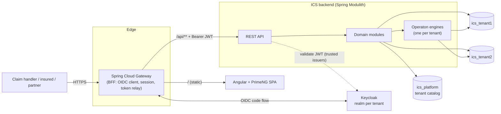
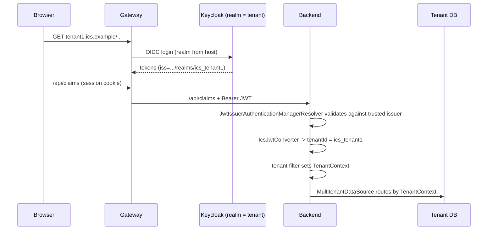

# ICS Architecture

Status: **proposal**. Decisions are recorded in [`decisions/`](decisions/). `services.svg` is the earlier high-level sketch.

## 1. Goals that shape the architecture

| Driver | Consequence |
|---|---|
| Each insurance company is a tenant, with hard data isolation | Database per tenant ([ADR-0001](decisions/0001-database-per-tenant.md)) |
| Each tenant runs its **own claim process**, assembled from a fixed set of building blocks | BPMN per tenant, executed by Operaton; blocks are code we own, processes are configuration they own ([ADR-0004](decisions/0004-process-building-blocks.md)) |
| Configurable and extendable without forking per customer | New behaviour = new block; new customer = new BPMN + forms, not new code |
| Starts small, may need to scale or split later | Spring Modulith monolith with enforced module boundaries ([ADR-0002](decisions/0002-spring-modulith-monolith.md)) |

## 2. System context

- **Keycloak**: one realm per tenant. The realm name is the tenant ID, and so is the last path segment of the token's `iss` claim. The backend already does this in `IcsJwtConverter`.
- **Spring Cloud Gateway**: the single public entry point. It serves the SPA and proxies `/api`. It acts as a **Backend-for-Frontend**: it runs the OIDC code flow against the tenant's realm and keeps tokens server-side. The browser only holds an HTTP-only session cookie. See [ADR-0005](decisions/0005-gateway-as-bff.md).
- **Backend**: a stateless OAuth2 resource server. Every request carries a JWT and the tenant is derived from it, never from a header the client controls.
- **PostgreSQL**: one database per tenant, holding both the domain tables and the Operaton tables. A small `ics_platform` catalog database holds the tenant registry (see §4.4).

## 3. Backend modules

Each top-level package under `com.ics.backend` is a Spring Modulith application module. Only its root package is API; everything under `internal` is private. This is enforced by the `ApplicationModules` test.

| Module | Responsibility | Exposes to other modules |
|---|---|---|
| `tenancy` | Tenant catalog, `TenantContext`, per-tenant `DataSource`s, Flyway per tenant, onboarding | `TenantContext`, `TenantRegistry`, tenant lifecycle events |
| `security` | JWT validation per trusted issuer, `IcsJwtToken`, tenant filter | current user / tenant accessors |
| `process` | Operaton engines per tenant, BPMN deployment and validation, block registry, task API | `ProcessBlock` SPI, `ClaimProcessGateway` (start/correlate), task queries |
| `claims` | Claim aggregate, lifecycle, claim numbers | claim service API, claim events; contributes claim blocks |
| `documents` | Upload/storage/classification of claim documents | document API; contributes document blocks |
| `communication` | Messages to claimants and partners (email, portal) | contributes notification blocks |
| `reporting` | Read models and analytics per tenant | — |
| `integration` | Adapters to external systems (policy admin, payments, fraud scoring) | contributes integration blocks |

The current code puts tenancy and security together in `common`. Split it as these modules grow. Note that Modulith treats `common` as a regular module, not as shared code.

**Dependency direction.** Domain modules depend on the `process` SPI (`ProcessBlock`). `process` never depends on domain modules. It finds blocks as Spring beans at runtime. Domain modules talk to each other through their APIs or through Spring Modulith application events.

**Identifiers.** Every aggregate uses an application-generated UUIDv7 as its ID, including in REST paths, events, logs and the Operaton business key. Claims also get a human-readable claim number, unique per tenant, in a tenant-configurable format (e.g. `ACME-2026-000123`). The claim number is for display and search only. See [ADR-0006](decisions/0006-identifiers.md).

## 4. Multi-tenancy

### 4.1 Tenant resolution (request threads)

The gateway maps the host (or path prefix) to a realm. This is the only place in the system where a client-visible value selects the tenant. It is safe because the backend accepts only tokens signed by a trusted issuer.

### 4.2 Tenant context outside request threads

`TenantContext` is a ThreadLocal, so anything that is not an HTTP request has to set it explicitly:

| Execution path | How the tenant is set |
|---|---|
| Operaton job executor (async continuations, timers) | Each tenant's engine has its own job executor. Its threads are created by a thread factory that pins `TenantContext` to that tenant (see [ADR-0003](decisions/0003-process-engine-per-tenant.md)) |
| Spring Modulith event listeners (`@ApplicationModuleListener`, async) | A `TaskDecorator` on the async executor copies `TenantContext` from the publishing thread |
| Event publication registry republish on restart | Republish per tenant, iterating the tenant registry with the context set |
| Scheduled jobs | Iterate tenants explicitly: `tenantRegistry.forEach(t -> runAs(t, job))` |

**Rule:** if the default tenant is ever used outside startup, it is a bug. Long term, `MultitenantDataSource` should **fail** when no tenant is set, rather than fall back to `ics_tenant1` as it does today.

### 4.3 Schema management

There are two sets of tables per tenant database: domain (Flyway, `db/migration`) and Operaton. Flyway must run **once per tenant** at startup and on onboarding. Today it runs only through the routing DataSource, so it effectively migrates only the default tenant. Manage the Operaton DDL through Flyway as well (vendored engine SQL scripts), with `databaseSchemaUpdate=false`, so that engine upgrades go through a reviewed migration.

### 4.4 Tenant catalog and onboarding

Tenants are configured today by `db/connections/*.properties` on the classpath, so adding one requires a rebuild. The proposal is to move them into an `ics_platform` database (tenant ID, display name, JDBC URL, credentials reference, issuer, status), loaded at startup. Onboarding then becomes a runtime operation:

1. Create the database (or point at a provisioned one) and register it in the catalog.
2. Run Flyway (domain and Operaton schema) against it.
3. Create the Keycloak realm from a template via the Keycloak Admin API, and add its issuer to the trusted issuers.
4. Build and register the tenant's DataSource and Operaton engine, then start its job executor.
5. Deploy the tenant's initial claim process (a copy of the reference process).

This means `JwtIssuerAuthenticationManagerResolver.fromTrustedIssuers(...)` must take a dynamic `Predicate<String>` backed by the catalog instead of a static list.

## 5. Process engine: Operaton

[Operaton](https://operaton.org) is the open-source fork of Camunda 7 (embedded Java engine, BPMN/DMN, Apache 2.0). We use it **embedded** in the backend, not as a separate server. Engine calls then share the Spring transaction with domain writes.

### 5.1 One engine per tenant

With database per tenant, Operaton's own `tenantId` column multi-tenancy (shared tables) does not fit. Instead, the `process` module builds **one `ProcessEngine` per tenant**, named after the tenant ID, at startup and on onboarding. Engine lookup then becomes `processEngines.forTenant(TenantContext.getCurrentTenant())`. Do not inject `ProcessEngine`/`RuntimeService` directly: there is more than one.

The Spring Boot starter auto-configures only one engine, so the per-tenant engines are built programmatically (`SpringProcessEngineConfiguration` per tenant). Details and trade-offs are in [ADR-0003](decisions/0003-process-engine-per-tenant.md).

### 5.2 Process definitions per tenant

- Each tenant has its own deployment of the process key `claim-handling` (plus sub-processes) in its own engine. Versions are independent per tenant.
- We maintain a **reference process** that new tenants start from.
- Running instances stay on the version they started with. Migration between versions is an explicit admin action that uses Operaton's migration API.

### 5.3 Building blocks

A tenant's process is assembled only from blocks we provide. A block is:

| Part | Purpose |
|---|---|
| Java implementation (`ProcessBlock`, a Spring bean in the owning module) | The behaviour, e.g. `claims.assessCoverage`, `documents.requestDocuments`, `communication.notifyClaimant`, `integration.fraudScore` |
| Block ID and version | Stable name referenced from BPMN |
| Element template (JSON) | Describes the block in the modeler: its typed inputs/outputs, so modelers fill fields instead of writing expressions |
| Contract | Input/output variables, the BPMN errors it can throw, idempotency guarantees |

There are also **user task blocks** (assess claim, approve payout, request info), each bound to a known Angular form component. Their configuration (field visibility, required documents, approval limits) is data, not code.

Allowed BPMN constructs: service tasks that reference a registered block; user tasks that reference a registered form; gateways with **simple** conditions on process variables; timers, messages, errors, sub-processes and call activities within the tenant; and DMN decision tables, which are where tenant-specific rules belong (thresholds, routing, SLAs).

**Validation on deployment** is a security boundary, because tenant-authored BPMN runs inside our JVM. Deployment is rejected if it contains script tasks, unknown block IDs, Java class references (`operaton:class`), or delegate/listener expressions. Only whitelisted variable expressions are allowed in conditions. The engine is also configured to expose **no** Spring beans to the expression language except the block dispatcher.

### 5.4 Modeling experience

- **Phase 1:** business analysts use the desktop modeler (Camunda Modeler for C7 / Operaton-compatible) with our element templates. They deploy through an admin endpoint that validates and deploys into their tenant's engine.
- **Phase 2:** an embedded modeler in the Angular admin UI (bpmn-js + element templates, palette restricted to blocks), using the same validation and deployment endpoint.

## 6. Frontend

- Angular with PrimeNG, one SPA for all tenants. Tenant branding and configuration are loaded after login from `/api/tenant/config`.
- Main areas: **claims** (search, detail, timeline), **tasklist** (user tasks from the tenant's engine, rendered with the registered form component), **documents**, and **admin** (process versions, deployment, block catalog, DMN tables).
- Authentication goes through the gateway session (BFF), so the SPA does not handle tokens. The current `angular-oauth2-oidc` setup is a transitional step.

## 7. Open questions and spikes

1. **Operaton version vs. Spring Boot 4.2 / Java 26.** We have not verified that Operaton ships a Spring Boot 4–compatible starter. Upstream Camunda 7.24.3+ publishes separate `-4` artifacts for Spring Boot 4. Spike: run an Operaton engine in `ics-backend` on the current parent POM. Fallback: move the backend to Spring Boot 3.5 until the starter is available.
2. **Engine per tenant: cost.** Each engine has its own job executor and caches. Measure memory and connection use at about 20 tenants. Consider a shared job executor thread pool with per-engine acquisition.
3. **Transactions.** Confirm that engine commands and JPA writes in a delegate share one transaction and one connection (see ADR-0003).
4. **Keycloak realm per tenant vs. Organizations.** Keycloak 26 Organizations would allow a single realm. That makes cross-tenant users (partners, adjusters working for several insurers) easier, but tenant isolation becomes a claim check rather than an issuer check. The current code and this proposal use a realm per tenant. Revisit if cross-tenant users become a requirement. Also upgrade Keycloak (docker-compose pins 22.0).
5. **Cross-tenant reporting** (platform operator view). This is out of scope for now; if needed, use an export pipeline, not cross-database queries.
6. **Document storage.** Choose between the DB, S3-compatible object storage per tenant bucket, and a DMS integration.
